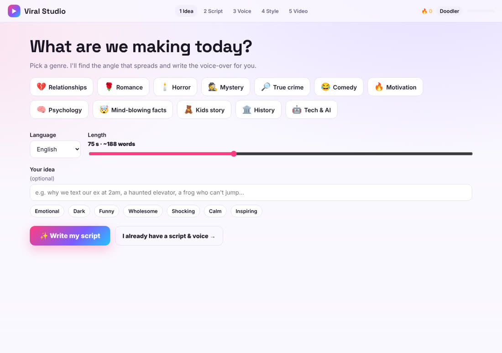
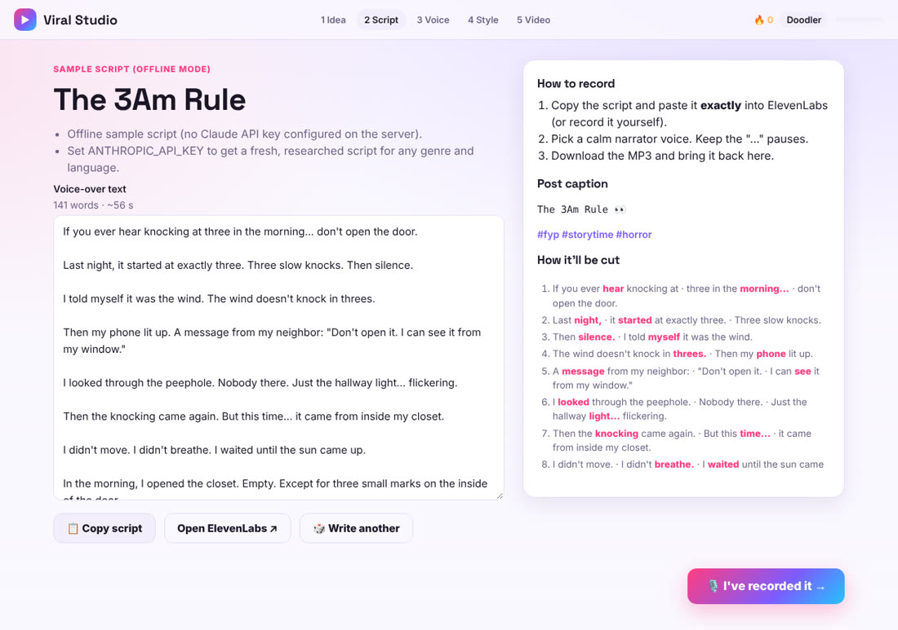
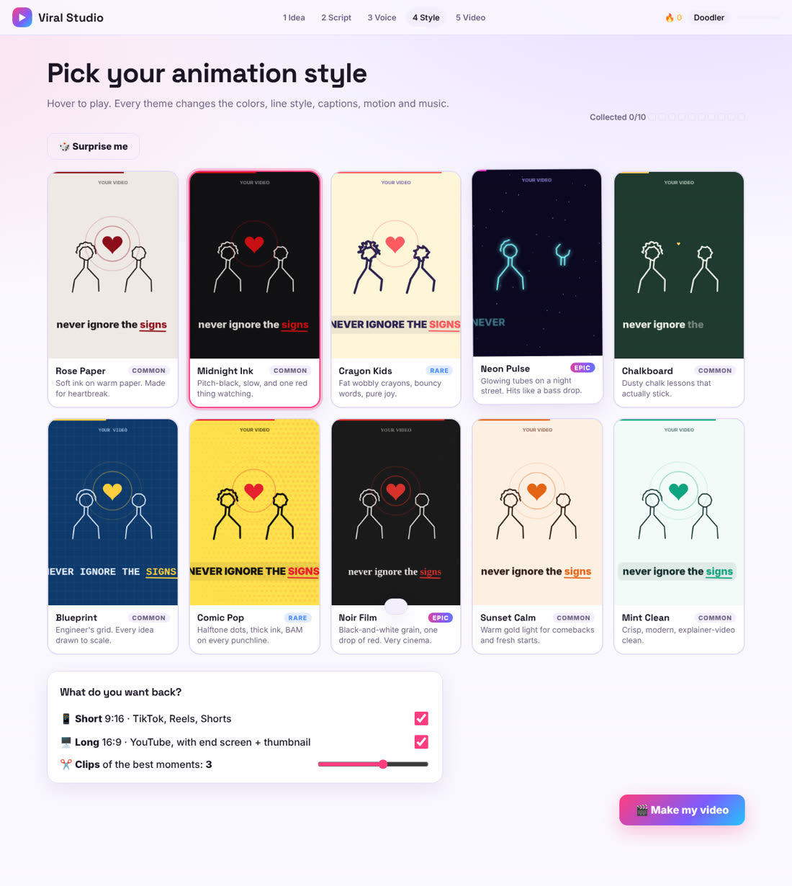
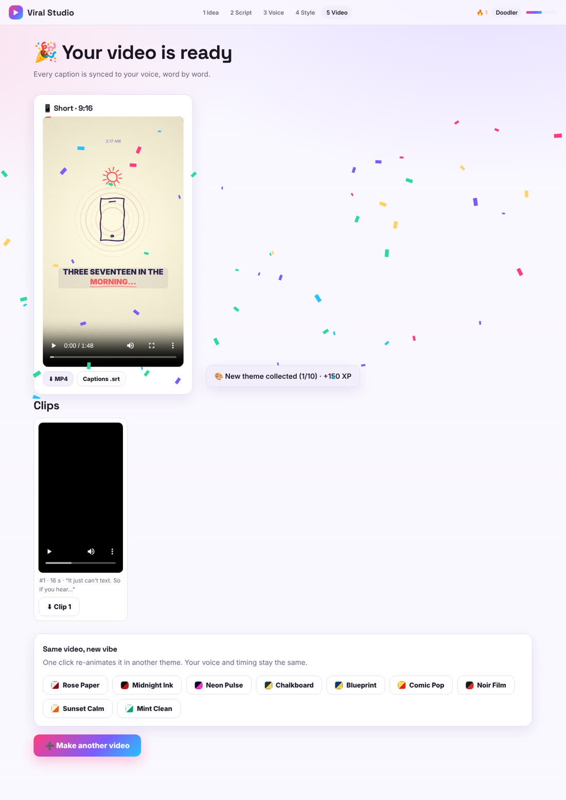
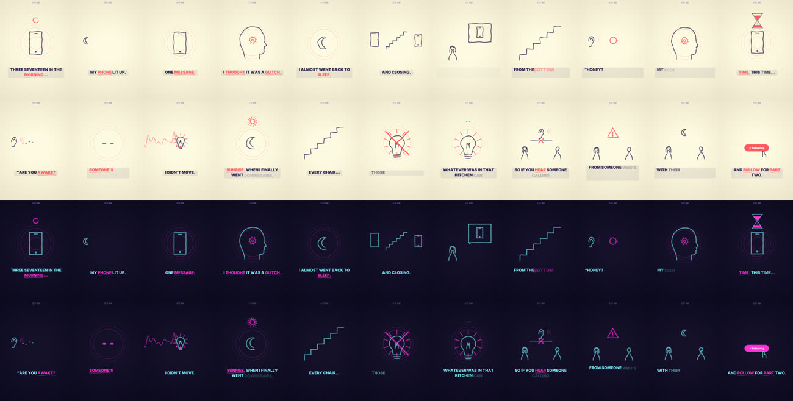

# ▶ Viral Studio

**Turn an idea into finished, animated, faceless videos for TikTok, Reels, Shorts and YouTube.**

Pick a genre, and Viral Studio writes a voice-over script designed to spread. You record it (for example with ElevenLabs) and upload the MP3. Viral Studio syncs every word to your voice and hand-draws the whole video in the animation style you choose. You get back:

- 📱 a **Short** (1080×1920, 9:16) for TikTok, Instagram Reels and YouTube Shorts
- 🖥️ a **Long** YouTube version (1920×1080, 16:9) with an end screen, a Subscribe button and a thumbnail
- ✂️ **Clips**: the best 15–45 second moments, found and cut automatically
- 📝 `.srt` caption files for every format

Everything renders on your own machine with Python, cairo and ffmpeg. There are no paid video services and no stock footage. The only optional paid piece is the Claude API, which writes the scripts.



---

## Contents

1. [Features](#features)
2. [Screenshots](#screenshots)
3. [Quick start](#quick-start)
4. [Install in detail](#install-in-detail)
5. [Configuration](#configuration)
6. [How to make a video, step by step](#how-to-make-a-video-step-by-step)
7. [Try it with the sample voice-over](#try-it-with-the-sample-voice-over)
8. [Animation themes](#animation-themes)
9. [What you get back](#what-you-get-back)
10. [How it works](#how-it-works)
11. [Project structure](#project-structure)
12. [API reference](#api-reference)
13. [Customizing](#customizing)
14. [Troubleshooting](#troubleshooting)
15. [Running it on a server](#running-it-on-a-server)
16. [Limits and roadmap](#limits-and-roadmap)

---

## Features

**Script writing**
- 12 genres: Relationships, Romance, Horror, Mystery, True crime, Comedy, Motivation, Psychology, Mind-blowing facts, Kids story, History, Tech & AI
- 9 languages: English, French, Spanish, Portuguese, German, Italian, Arabic, Turkish, Indonesian
- Choose the length (30–150 s), add your own idea, and pick a tone (Emotional, Dark, Funny, Wholesome, Shocking, Calm, Inspiring)
- Claude writes with a proven viral formula: **hook in the first 3 seconds → tension → story → twist → payoff → call to action**. Every line is short, concrete and drawable.
- Along with the script you get a post caption, hashtags, an on-screen label, a YouTube title, "why this will travel" notes and backup ideas
- A preview shows how the script will be split into scenes before you record

**Automatic animation**
- The script is split into scenes and caption cards automatically, and the key words are highlighted
- Meaning is turned into drawings. 29 visual kinds include phone, heart, broken heart, night, door, storm, lightning, fire, idea bulb, clock, stairs, eyes in the dark, money, brain, sunrise, a target and footprints.
- Layouts adapt to each line: one big image, two people, one person thinking, a list of three, a big number, and a closing scene with a Follow or Subscribe tap
- "Not / never / don't" gets a red ✗, and questions get a wobbling "?"
- Captions appear word by word, exactly when each word is spoken, with a pop and an underline on the key words

**Sync**
- English: the script is aligned to your recording word by word, offline. In testing it landed within about 0.01 s of hand-checked timings.
- Other languages: the pauses in your voice are matched to the punctuation in your script. In testing a typical word landed within about 0.1 s.

**Sound**
- 29 sound effects synthesized from scratch (heartbeat, phone buzz, thunder, footsteps, door thud, chime…), placed on the moments they belong to
- A music bed that matches the theme's mood and ducks under your voice
- Loudness normalized to −14 LUFS, the level TikTok, Instagram and YouTube expect

**10 animation themes**, from cute to cinematic. Each one changes the colors, line style, texture, caption font, motion energy and music. See [Animation themes](#animation-themes).

**Keeps you coming back**
- *Same video, new vibe*: re-animate a finished video in another theme with one click. Your voice and timing are reused.
- Theme collection ("Collected 4/10") with common, rare and epic theme tiers
- 🎲 *Surprise me*: a dice roll through the themes
- XP levels (Doodler → Sketcher → Animator → Director → Studio Legend → Viral Machine), a daily streak 🔥, confetti and "new theme collected" pop-ups

---

## Screenshots

| Script | Theme picker (live animated previews) |
|---|---|
|  |  |

| Results | The same video in two themes (Crayon Kids and Neon Pulse) |
|---|---|
|  |  |

---

## Quick start

You need **Python 3.10+** and **ffmpeg**. Details are in [Install in detail](#install-in-detail).

```bash
git clone https://github.com/meddeb147/testDh.git
```
```bash
cd testDh
```

**Mac / Linux**
```bash
./run.sh
```

**Windows** (double-click `run.bat`, or in a terminal):
```bash
run.bat
```

Open **http://127.0.0.1:8000** in your browser. Keep the terminal open while you use the site, and press **Ctrl+C** to stop it.

> Without an Anthropic API key the site still works, but step 2 shows built-in sample scripts. Add a key to get fresh scripts for any genre and language (see [Configuration](#configuration)).

**Docker** (everything included: ffmpeg, cairo, fonts):
```bash
docker build -t viral-studio .
```
```bash
docker run -p 8000:8000 -e ANTHROPIC_API_KEY=your-key -v "$PWD/data:/app/data" viral-studio
```

---

## Install in detail

### 1. Python 3.10 or newer
- Download it from https://www.python.org/downloads/. On Windows, tick **"Add Python to PATH"** during setup.
- Check it works: `python3 --version` (Mac/Linux) or `python --version` (Windows).

### 2. ffmpeg (video and audio encoding)

| System | Command |
|---|---|
| Windows | `winget install Gyan.FFmpeg`, then open a new terminal |
| Mac | `brew install ffmpeg` |
| Ubuntu / Debian | `sudo apt install ffmpeg` |

Check it works: `ffmpeg -version`

### 3. cairo (the drawing library)
`pip` installs `pycairo` for you. On Windows it comes ready-made. On Mac and Linux it builds from source and needs the cairo headers first:

| System | Command |
|---|---|
| Mac | `brew install cairo pkg-config` |
| Ubuntu / Debian | `sudo apt install libcairo2-dev pkg-config python3-dev` |

### 4. Fonts (recommended)
Captions use **Inter**. Two themes also use **JetBrains Mono** (Blueprint) and **DejaVu Serif** (Noir Film). If a font is missing, the video still renders but falls back to a default font.
- Inter: https://rsms.me/inter/ (or `sudo apt install fonts-inter`)
- JetBrains Mono: https://www.jetbrains.com/lp/mono/ (or `sudo apt install fonts-jetbrains-mono`)

### 5. Python packages
`run.sh` and `run.bat` install these automatically. To do it by hand:
```bash
pip install -r requirements.txt
```
The packages are `fastapi`, `uvicorn`, `python-multipart` (web server), `anthropic` (script writing), `pycairo` and `numpy` (drawing), and `pocketsphinx` (offline word alignment). Using a virtual environment is a good idea:
```bash
python3 -m venv .venv
```
```bash
source .venv/bin/activate
```
On Windows, activate it with `.venv\Scripts\activate` instead.

---

## Configuration

Copy `.env.example` to `.env` and fill it in. `run.sh` loads it automatically. On Windows, set the values in the terminal before running `run.bat`.

| Setting | What it does | Default |
|---|---|---|
| `ANTHROPIC_API_KEY` | Lets Claude write the scripts. Create a key at https://console.anthropic.com | not set: sample scripts are used |
| `STUDIO_DATA` | Folder where projects and videos are stored | `./data/projects` |
| `HOST` | Address the server listens on | `127.0.0.1` |
| `PORT` | Port | `8000` |

Setting a variable in a terminal:
- Mac / Linux:
  ```bash
  export ANTHROPIC_API_KEY=your-key
  ```
- Windows PowerShell:
  ```bash
  $env:ANTHROPIC_API_KEY="your-key"
  ```

Scripts are written by **Claude Opus 5.5** (`claude-opus-5-5`) using structured JSON output. If Claude declines a request, the API automatically retries on a fallback model. One script costs roughly a few cents.

---

## How to make a video, step by step

1. **Idea:** pick a genre, a language and a length. Optionally type your own idea and pick a tone, then click **✨ Write my script**.
   Already have a script and a recording? Click **"I already have a script & voice →"** to skip ahead.
2. **Script:** read it and edit anything you like. Click **📋 Copy script**.
3. **Record it:**
   - In [ElevenLabs](https://elevenlabs.io/app/speech-synthesis), paste the script **exactly**. Pick a calm narrator voice, generate it and download the MP3. You can also record yourself (phone voice memo → MP3, WAV or M4A).
   - Keep the "…" pauses. They become dramatic beats in the video.
4. **Voice:** drop the MP3 on the page. Fill in a title and the label shown at the top of every frame.
   Make sure the **"Exact spoken text"** box matches what was actually said. If you changed words while recording, change them here too. This is what makes every caption land on the right word.
5. **Style:** hover over the themes to watch their previews, then pick one (or hit 🎲 *Surprise me*). Choose what you want back: Short, Long and/or 0–5 Clips. Click **🎬 Make my video**.
6. **Wait about 2–4 minutes** for a 90-second video. The page shows each stage live.
7. **Results:** watch and download the Short, the Long, the clips, the captions (`.srt`) and the thumbnail.
   Want a different look? Under **Same video, new vibe**, click another theme. It re-renders without re-uploading anything, and you can switch between versions with the tabs.

**Posting tips**
- Post the Short first, then one clip every day or two. Each clip is a new chance to go viral.
- On YouTube, upload the Long video's `.srt` under *Subtitles → Upload file → With timing*. In YouTube Studio's *End screen* editor, place two videos and a Subscribe element over the empty frames of the last 8 seconds.
- Use the caption and hashtags from step 2.

---

## Try it with the sample voice-over

`samples/3-17-am/` contains a real ElevenLabs recording (a 1:46 horror story) and its exact text, so you can test the whole pipeline without recording anything:

1. On the first page click **"I already have a script & voice →"**.
2. Upload `samples/3-17-am/voice-over.mp3`.
3. Paste the contents of `samples/3-17-am/spoken-text.txt` into **Exact spoken text**.
4. Give it a title (e.g. *Never Answer This Text at 3:17 AM*) and a label (*3:17 AM*), then pick a theme and make the video.

Or from a terminal, while the server is running:
```bash
curl -F audio=@samples/3-17-am/voice-over.mp3 -F "script=$(cat samples/3-17-am/spoken-text.txt)" -F genre=horror -F theme=midnight-ink -F formats=short,long -F clips=3 -F title="Never Answer This Text" -F label="3:17 AM" http://127.0.0.1:8000/api/projects
```

---

## Animation themes

| Theme | Rarity | Vibe | Look | Music |
|---|---|---|---|---|
| **Rose Paper** | common | emotional | soft ink on warm paper, deep red | tender |
| **Midnight Ink** | common | serious, scary | pitch black, slow strokes, one red accent | dark |
| **Crayon Kids** | rare | childish, playful | fat wobbly crayon lines, bouncy CAPITAL captions, pastel paper | playful |
| **Neon Pulse** | epic | energetic | glowing neon tubes on a starry night | uplifting |
| **Chalkboard** | common | smart | dusty chalk on a green board | uplifting |
| **Blueprint** | common | serious, techy | engineer's grid, typewriter font | dark |
| **Comic Pop** | rare | funny | yellow halftone dots, thick ink, BAM captions | playful |
| **Noir Film** | epic | cinematic | black-and-white grain, serif captions, one drop of red | dark |
| **Sunset Calm** | common | uplifting | warm gold light | uplifting |
| **Mint Clean** | common | clean, modern | crisp explainer style | uplifting |

When you pick a genre, a matching theme is preselected (Horror → Midnight Ink, Kids story → Crayon Kids…), and you can change it.

---

## What you get back

Files are saved in `data/projects/<project-id>/out/<theme>/`:

| File | What it is |
|---|---|
| `short.mp4` | 1080×1920 vertical video, H.264 + AAC, −14 LUFS |
| `short.srt` | captions for the Short |
| `cover.jpg` | a cover frame for the Short |
| `long.mp4` | 1920×1080 YouTube video with an 8 s end screen |
| `long.srt` | subtitles for YouTube |
| `thumbnail.jpg` | 1280×720 YouTube thumbnail with your title |
| `clip_1.mp4` … | the best moments, 9:16, with fade in and out |
| `clips.json` | where each clip starts and ends, and why it was picked |

---

## How it works

```
 idea ──► Claude script ──► you record ──► upload MP3 + exact text
                                                    │
                    ┌───────────────────────────────┘
                    ▼
   planner.py   split into scenes and caption cards, pick key words,
                map meaning to drawings (phone, heart, stairs, ✗, ?…)
                    ▼
   timing.py    English: word-level forced alignment (pocketsphinx)
                other languages: pauses ↔ punctuation fitting
                    ▼
   render_one   engine draws every frame with cairo in the chosen theme
   (per format) → sound effects + mood music mixed under the voice
                → ffmpeg encodes MP4 at −14 LUFS, writes .srt, thumbnail
                    ▼
   clips.py     score scenes (hook, twists, questions, emotion, payoff)
                → cut the best 15–45 s windows from the Short
```

- **Script writer (`server/scriptgen.py`):** sends the viral-script playbook plus your choices to Claude and gets back validated JSON (script, caption, hashtags, label, titles, ideas). Without an API key it uses built-in templates.
- **Scene planner (`server/planner.py`):** splits sentences into scenes of about 9–24 words and caption cards of up to 6 words, picks 1–2 highlight words per scene, and chooses a layout and drawings from keywords. It produces plain JSON (`plan.json`), so a project can be re-rendered in any theme without re-planning.
- **Word timing (`server/timing.py`):** for English, the whole text is force-aligned to the audio. Words the dictionary doesn't know (names, "3:17") are filled in between their neighbours. For other languages, speech stretches between pauses are detected, and a dynamic program decides which words belong to each stretch. It uses the speaking rate and prefers to break at punctuation.
- **Engine (`server/vme/`):** `engine.py` is a hand-drawn motion-graphics engine. It has strokes that draw themselves, pop-in shapes, 60+ icons, effects and captions. It renders both 9:16 and 16:9, and a theme controls the stroke weight, wobble, neon glow, texture (paper, grid, chalk, halftone, stars), caption font, pop size and camera motion. `sfx.py` synthesizes the sound effects and music and mixes them under the voice. `align.py` handles offline speech alignment.
- **Jobs (`server/pipeline.py`):** a background worker renders one project at a time. Each format runs in its own process, and progress is written to `status.json`, which the website polls.
- **Website (`web/`):** a single page with no framework or build step: `index.html`, `styles.css` and `app.js`. The theme previews are drawn live on `<canvas>` with each theme's real colors and style. Your XP, streak and collection are stored in your browser.

---

## Project structure

```
.
├── README.md              ← you are here
├── run.sh                 ← start on Mac / Linux
├── run.bat                ← start on Windows
├── Dockerfile             ← container with every dependency
├── requirements.txt       ← Python packages
├── .env.example           ← settings template (copy to .env)
├── server/
│   ├── app.py             ← FastAPI web server + API
│   ├── scriptgen.py       ← Claude script writer + offline templates, genres, languages
│   ├── planner.py         ← script → scenes, captions, highlights, visuals; build() for the engine
│   ├── timing.py          ← word timings (alignment / pause fitting)
│   ├── render_one.py      ← renders one format of one project (+ thumbnail, cover, .srt)
│   ├── clips.py           ← best-moment finder and clip cutter
│   ├── pipeline.py        ← background job queue and status
│   ├── themes.py          ← the 10 animation themes
│   └── vme/               ← the motion-graphics engine
│       ├── engine.py      ← drawing, icons, captions, themes, frame renderer
│       ├── sfx.py         ← synthesized sound effects + music + mixing
│       └── align.py       ← offline speech alignment helpers (pocketsphinx)
├── web/
│   ├── index.html         ← the app page
│   ├── styles.css         ← styles (light + dark)
│   └── app.js             ← wizard, theme previews, progress, results, XP
├── samples/3-17-am/       ← demo voice-over + exact text
├── docs/screenshots/      ← images used in this README
└── data/                  ← created at runtime: your projects and videos (git-ignored)
```

---

## API reference

All endpoints are on the same server as the website.

### `GET /api/meta`
Returns the themes, genres, languages, the default theme for each genre, and whether Claude is configured.

### `POST /api/script`
```json
{ "genre": "horror", "language": "English", "seconds": 75, "topic": "a haunted elevator", "tone": "Dark" }
```
Returns `title`, `label`, `script`, `caption`, `hashtags`, `youtube_title`, `why_it_travels`, `backup_ideas`, `words`, `est_seconds`, `scenes_preview` and `source` (`claude` or `offline`).

### `POST /api/projects` (multipart form)

| Field | Required | Example |
|---|---|---|
| `audio` | ✔ | MP3 / WAV / M4A, up to 40 MB and 5 min |
| `script` | ✔ | the exact spoken text |
| `theme` | | `midnight-ink` (default `rose-paper`) |
| `formats` | | `short,long` |
| `clips` | | `0`–`5` (default 3) |
| `genre`, `language`, `title`, `label`, `youtube_title` | | |

Returns `{"id": "5c1d3decb762"}` and starts rendering.

### `GET /api/projects/{id}`
Returns the project, the status (`stage`: `queued` → `plan` → `timing` → `render_short` → `render_long` → `clips` → `done` / `error`, plus `progress` and `message`) and `renders`: the output URLs for every theme rendered so far.

### `POST /api/projects/{id}/rerender`
```json
{ "theme": "neon-pulse", "formats": ["short"], "clips": 2 }
```
Re-renders the same project in another theme. The voice and timings are reused.

### `GET /media/{id}/out/{theme}/{file}`
Downloads the files listed in [What you get back](#what-you-get-back).

---

## Customizing

**Add or change a theme:** add a `T(...)` entry in `server/themes.py`:
```python
T("ocean-dream", "Ocean Dream", "Calm waves for calm minds.", "calm",
  "#e8f6fb", "#0b2b3a", "#1aa6c9", "#6f94a3", "#bfe3ee", "uplifting",
  dict(stroke=1.0, wobble=1.2, texture="paper", cap_font="Inter ExtraBold", cap_pop=0.2, punch=0.04),
  ["facts", "motivation"], "rare"),
```
The arguments are id, name, tagline, vibe, then the colors (background, ink, accent, grey, light), the music mood (`tender`, `dark`, `playful` or `uplifting`), the style, tags and rarity.
Style options:

| Option | Meaning |
|---|---|
| `stroke` | line thickness multiplier |
| `wobble` | hand-drawn jitter |
| `glow` | 0–1 neon halo |
| `texture` | `grain`, `paper`, `grid`, `chalk`, `halftone` or `stars` |
| `cap_font` | caption font name |
| `cap_upper` | captions in capital letters |
| `cap_pop` | how much a key word grows when it appears |
| `punch` | zoom bump on key words |
| `drift` | camera sway |
| `plate` | background strip behind captions |
| `label_font` | font of the label at the top |

The website picks the new theme up automatically.

**Teach it new visual keywords:** in `server/planner.py`, add words to a kind in `LIB`. For example, add `"cat kitten pet"` to a new `"star"` entry or an existing kind. To draw something new, add a branch in `_icon()` built from the engine's shapes (`arc`, `bez`, point lists).

**Add a genre:** add it to `GENRES` in `server/scriptgen.py`, and optionally map it to a theme in `GENRE_DEFAULT` in `server/themes.py`.

**Change the script formula:** edit `PLAYBOOK` in `server/scriptgen.py`.

---

## Troubleshooting

| Problem | Fix |
|---|---|
| `ffmpeg is not installed` / `FileNotFoundError: ffmpeg` | Install ffmpeg (see [Install in detail](#install-in-detail)) and open a **new** terminal. |
| `pip` fails on `pycairo` | Mac: `brew install cairo pkg-config`. Linux: `sudo apt install libcairo2-dev pkg-config python3-dev`. Then run `pip install -r requirements.txt` again. |
| Step 2 says "Sample script (offline mode)" | `ANTHROPIC_API_KEY` isn't set in the terminal that started the server. Set it and restart. |
| Captions are early or late | The **Exact spoken text** doesn't match the recording. Fix the words and make the video again. For non-English videos, timing is estimated from pauses, so clear pauses at the end of sentences help. |
| Captions look like a plain default font | Install Inter (and JetBrains Mono for Blueprint). |
| Rendering is slow | It uses one CPU core per render, at about 1–2 minutes per format for a 90 s video. Pick only the formats you need. |
| `Address already in use` | Another program uses port 8000. Run `PORT=8001 ./run.sh`, or on Windows edit the port in `run.bat`. |
| Arabic captions look disconnected | A known limit (see below). The script and voice-over work, but the caption letters don't join yet. |
| A render failed | The results page shows the error. The full log is in the terminal running the server. |

---

## Running it on a server

1. Use a Linux machine with at least 2 CPU cores and 4 GB RAM. The Docker image is the easiest route.
2. Run it behind a reverse proxy with HTTPS (Caddy, Nginx or Traefik), listening on `HOST=0.0.0.0`.
3. **Add authentication first.** There are no user accounts yet, so anyone with a project link can see its files. Put it behind a login (e.g. your proxy's basic auth or an identity provider) before sharing the URL.
4. Mount `data/` on persistent storage, and clean up old projects from time to time. Each project is about 30–80 MB.
5. Keep your API key in an environment variable or a secret manager, never in the code.

---

## Limits and roadmap

- **One render at a time.** For many users, move the queue to Redis/RQ or Celery and run several workers.
- **No accounts or payments yet.** Natural next steps: sign-in, per-user galleries, credits.
- **Right-to-left and complex scripts (Arabic…):** captions use cairo's simple text drawing, which doesn't join Arabic letters. Rendering captions with Pango/HarfBuzz would fix this.
- **Visual keywords are English.** Other languages get people, numbers, questions, negations and varied icons. Adding per-language keyword lists would make them as rich as English.
- **Ideas:** direct ElevenLabs integration (type, then voice, then video in one click), auto-posting, A/B thumbnails, more themes and icons.

---

*Viral Studio started as a hand-made workflow for faceless story videos ("Why Men Pull Away", "When She Goes Quiet", "3:17 AM") and grew into a site that automates every step.*
